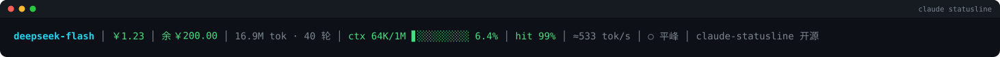

# claude-statusline

A single-file, zero-dependency status line for [Claude Code](https://claude.com/claude-code) that shows **what the current session is costing you** — live, in your own currency.



```
deepseek-flash │ ￥1.23 │ 余 ￥200.00 │ 16.9M tok · 40 轮 │ ctx 64K/1M ▋░░░░░░░░░ 6.4% │ hit 99% │ ≈533 tok/s │ ○ 平峰 │ claude-statusline 开源
```

Most status lines tell you the model and how full the context window is. This one answers the question you actually have two hours into a long session: **how much is this costing, and am I in the expensive hour?** It also fixes the accounting, because the obvious shortcuts get the numbers badly wrong.

## Features

- **Session cost** — either `$` straight from Claude Code's own accounting, or a **custom price table** for providers whose real rates differ (DeepSeek, regional resellers, self-hosted gateways).
- **Peak / off-peak pricing** — some providers charge double during business hours. The cost shown is what you'd actually be billed, request by request.
- **Correct token totals.** Claude Code writes one transcript line *per content block* (thinking / text / tool_use) for the same response, each repeating the full `usage` object. Counting lines inflates totals by ~2.4×. This counts `message.id` once.
- **Precise context usage** — uses Claude Code's own `context_window.used_percentage` when available, with a 1/8-block bar so a 1M window doesn't look frozen at zero.
- **Cache hit ratio** — on many providers a cache-hit token costs 1/50 of a miss; a dropping ratio is an early warning.
- **Token rate** — a *perceived* speed (includes queueing and time-to-first-token), labelled `≈` so it isn't mistaken for raw decode throughput.
- **Account balance** for providers with a balance endpoint, mathematically extrapolated between polls so it moves with the cost counter instead of jumping every two minutes.
- **Fast** — the transcript is parsed incrementally (only new bytes), self-capped state, no network calls on the render path. Typical render is a few milliseconds even on a 70 MB transcript.

## Install

```bash
git clone https://github.com/<you>/claude-statusline.git
cd claude-statusline
python3 install.py                        # generic: USD, straight from Claude Code
python3 install.py --provider deepseek    # + write the DeepSeek config
```

`install.py` backs up `~/.claude/settings.json`, sets the `statusLine` entry, and — with `--provider` — copies the example config to `~/.claude/statusline.json`. Restart Claude Code to see it.

Manual install: put this in `~/.claude/settings.json` (use absolute paths; JSON needs doubled backslashes on Windows):

```json
{
  "statusLine": {
    "type": "command",
    "command": "\"/usr/bin/python3\" -S -E \"/path/to/statusline.py\""
  }
}
```

`-S -E` skips site-packages and `PYTHON*` env vars: nothing here is imported, and startup stays cheap.

## Configure

Everything is optional. The script merges (in order) the first file it finds among:

1. `$CLAUDE_STATUSLINE_CONFIG`
2. `~/.claude/statusline.json`
3. `pricing.json` next to the script
4. built-in defaults

```json
{
  "currency": { "symbol": "￥", "code": "CNY" },
  "models": {
    "deepseek-flash": [0.02, 1.0, 4.0]
  },
  "peak": { "multiplier": 2.0, "weekdays_only": true, "windows": [[9, 12], [14, 18]] },
  "balance": { "url": "{base}/user/balance", "format": "deepseek", "ttl": 120, "retry": 120 },
  "labels": { "balance": "余", "turns": "轮", "peak": "◉ 高峰", "offpeak": "○ 平峰" },
  "show": { "session_name": true, "cache_hit": true, "balance": true, "token_rate": true },
  "rate_mode": "turn"
}
```

| Key | Meaning |
|:---|:---|
| `models` | `model id → [cache-hit, input, output]`, cost per **1M tokens**, off-peak. If the current model is listed, cost is computed from the transcript instead of trusting `cost.total_cost_usd`. Empty = passthrough mode. |
| `peak.multiplier` | Multiplier applied inside `windows` on weekdays (`weekdays_only: false` applies every day). |
| `peak.windows` | `[start_hour, end_hour)` pairs in **local time**. |
| `balance.url` | `{base}` expands to `ANTHROPIC_BASE_URL` minus its `/anthropic` tail. |
| `balance.format` | `"deepseek"` reads `balance_infos[0].total_balance`; `"path"` reads a dot path from `balance.path` (e.g. `"data.credits"`). |
| `balance.ttl` / `retry` | Seconds between refreshes / after a failure. Fetches happen in a detached child process, never on the render path. |
| `labels` | Any text, so you can run it in any language. |
| `rate_mode` | `turn` (last request) or `avg` (session mean; needs `cost.total_api_duration_ms`). |

### DeepSeek

```bash
cp examples/deepseek.json ~/.claude/statusline.json
```

The example bills CNY with the official off-peak rates and doubles them 09:00–12:00 and 14:00–18:00 on weekdays. Its `balance` block hits `/user/balance` using `ANTHROPIC_AUTH_TOKEN`, which Claude Code already exports.

### Anything else

Map whatever `message.model` strings appear in your transcripts to rates:

```json
{ "models": { "glm-4.6": [0.0, 4.0, 16.0], "kimi-k2": [0.0, 4.0, 16.0] } }
```

Leave `balance` out if your provider has no balance endpoint — nothing else changes.

## Environment variables

| Variable | Effect |
|:---|:---|
| `CLAUDE_STATUSLINE_CONFIG` | Explicit config path (wins over everything). |
| `CLAUDE_STATUSLINE_HOME` | Where `state.json` / `balance.json` live. Default `~/.claude/statusline/`. |
| `CC_STATUS_WINDOW` | Force the reference window (e.g. `200000`) to compare scales. Overrides the payload's `context_window_size` and disables its percentage. |
| `CC_RATE_MODE` | `turn` or `avg`, overrides the config. |

## How the numbers work

**Deduplication.** For one API response Claude Code writes several transcript lines (one per content block), each with an identical `usage` object. Any tool that trusts line counts over-reports by roughly 2.4×. This keeps a set of `message.id`s and bills each once.

**Cost.** In custom mode, each request is priced individually at the rate in force when it was made — a turn that ran at 09:59 and one at 10:01 are billed differently, which is why the split is per request rather than per day.

**Balance.** A raw cached balance would sit still for up to `ttl` seconds while cost ticks up, which reads as "frozen". So the display is `cached_truth − (current_cost − cost_when_fetched)`, anchored per session and re-calibrated on every fetch. Concurrent sessions each keep their own anchor, and a transcript rebuild (compaction) doesn't break the arithmetic.

**Rate.** The transcript has no streaming timestamps — the content blocks of one response land within about a second of each other, so block-to-block deltas produce absurd figures. The only real interval available is *user/tool_result record → assistant record*. It includes queueing and time-to-first-token, hence the `≈` and the two sanity guards on samples.

**Speed.** State is appended incrementally (a stored byte offset), capped at the 8 most recent sessions, and written atomically (`os.replace`) because the status line is invoked concurrently and often.

## Requirements

Python 3.8+. No third-party packages. Works on Linux, macOS, and Windows — including the Windows console-code-page trap, where a UTF-8 status line silently renders blank unless `sys.stdout` is reconfigured.

## Development

```bash
python3 tests/test_statusline.py   # 20 assertions, stdlib only
python3 docs/make_demo.py          # regenerates docs/demo.svg from a sample run
```

The tests cover message deduplication, peak multipliers, weekend handling, token rate, compact vs pretty-printed transcripts, context math, the five balance-extrapolation edge cases, and "never print a traceback into the status line".

## License

MIT — see [LICENSE](LICENSE).
