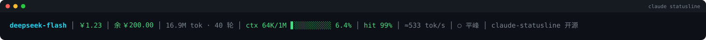

# claude-statusline

[Claude Code](https://claude.com/claude-code) 的单文件、零依赖状态栏，实时显示**当前会话花了多少钱**——用你自己的货币，按服务商**真实价目**计算。

专为其他状态栏没能覆盖的场景而做：**Claude Code 接第三方 Anthropic 兼容接口**——DeepSeek、GLM、Kimi、OpenRouter、自建网关。



```
deepseek-flash │ ￥1.23 │ 余 ￥200.00 │ 16.9M tok · 40 轮 │ ctx 64K/1M ▋░░░░░░░░░ 6.4% │ hit 99% │ ≈533 tok/s │ ○ 平峰 │ claude-statusline 开源
```

长会话跑到两小时后，你真正关心的是：**这一场花了多少，我现在是不是在贵的那几个小时里？**在第三方接口上，常见的几种算法都会把这两个数算错——见[适用场景](#适用场景)。

## 功能

- **会话花费**——直接用 Claude Code 自己算的 `$`，或者给「真实价目和内置定价不一致」的服务商配一张**自定义价目表**（DeepSeek、区域代理、自建网关）。
- **峰谷价**——部分服务商工作时段翻倍收费。这里显示的是逐请求、按当时费率算出的**实付**金额。
- **法定节假日**——服务商在全天按平峰计价的日期（DeepSeek 排除中国法定节假日）。日期区间可配置，不是写死的日历。
- **正确的 token 总数**。Claude Code 对同一个响应会**按 content block 分行写入**（thinking / text / tool_use 各一行），每行 `usage` 完全相同。按行统计会虚高约 2.4 倍；这里按 `message.id` 去重，一个响应只计一次。
- **精确的上下文占用**——有 `context_window.used_percentage` 时直接用 Claude Code 的官方值；进度条用 1/8 方块，1M 窗口不会整场都卡在「0 格」。
- **缓存命中率**——很多服务商命中 token 只收未命中的 1/50，命中率下滑是账单失控的早期信号。
- **生成速率**——**感知速度**（含排队与首字延迟），统一带 `≈` 前缀，避免被误解成纯解码吞吐。
- **账户余额**——支持余额接口的服务商可显示，并在两次轮询之间做线性推算，让余额与花费同帧变化，而不是每两分钟跳一次。
- **快**——转录**增量解析**（只读新增字节），state 只留最近 8 个会话，渲染路径上没有任何网络调用。70 MB 转录首次扫描后的每次刷新都在毫秒级。

## 适用场景

Claude Code 状态栏生态已经很拥挤：[CCometixLine](https://github.com/Haleclipse/CCometixLine)（Rust，30+ 指标、全屏配置器、皮肤）、[nilbuild/claude-statusline](https://github.com/nilbuild/claude-statusline)、[rz1989s/claude-code-statusline](https://github.com/rz1989s/claude-code-statusline) 等等。它们围绕**订阅配额**设计——Pro/Max 的 5 小时 / 7 天限流，加上主题和排版。如果你用 Anthropic 订阅跑 Claude Code，用它们就好。

这个项目针对另一种配置，上面那套功能一条都用不上：

| | 订阅（Claude Pro/Max） | 第三方接口（本项目） |
|:---|:---|:---|
| 5 小时 / 7 天配额 | 核心功能 | **不存在** |
| `cost.total_cost_usd` | 准确 | **错误**——Claude Code 用 Claude 的价目去算它不认识的模型 |
| 峰谷计费 | 无 | 视服务商而定，最高 2 倍 |

第二行就是它存在的理由。在一个真实的 DeepSeek 会话上，payload 报的是 `$45.45`；同一段转录按服务商官方价目算只有 `￥4.66`——差约 69 倍。头部项目修不了这个：它们的模型配置里只有**名字**和**上下文窗口**，没有**价格表**（[CCometixLine 的 `models.toml`](https://github.com/Haleclipse/CCometixLine) 就只设这两项）。这里的价格是配置的一等公民。

另外还有几个更早的、专门针对 DeepSeek 的状态栏，与本项目部分目标重合——见 [docs/PRIOR_ART.md](docs/PRIOR_ART.md)，那里做了逐项对比。

## 安装

```bash
git clone https://github.com/<you>/claude-statusline.git
cd claude-statusline
python3 install.py                        # 通用：美元，直接用 Claude Code 的账
python3 install.py --provider deepseek    # 额外写入 DeepSeek 配置
```

`install.py` 会先备份 `~/.claude/settings.json`，再写入 `statusLine` 条目；带 `--provider` 时还会把示例配置复制到 `~/.claude/statusline.json`。重启 Claude Code 生效。

手动安装——把下面这段写进 `~/.claude/settings.json`（用绝对路径；Windows 下 JSON 里反斜杠要写双份）：

```json
{
  "statusLine": {
    "type": "command",
    "command": "\"/usr/bin/python3\" -S -E \"/path/to/statusline.py\""
  }
}
```

`-S -E` 跳过 site-packages 和 `PYTHON*` 环境变量：本脚本不 import 任何第三方库，这样启动最快。

## 配置

全部可选。脚本按下列顺序找**第一个存在**的配置文件，并合并到内置默认值之上：

1. `$CLAUDE_STATUSLINE_CONFIG`
2. `~/.claude/statusline.json`
3. 脚本同目录的 `pricing.json`
4. 内置默认值

```json
{
  "currency": { "symbol": "￥", "code": "CNY" },
  "models": {
    "deepseek-flash": [0.02, 1.0, 4.0]
  },
  "peak": { "multiplier": 2.0, "weekdays_only": true, "windows": [[9, 12], [14, 18]],
            "holidays": ["2026-10-01..2026-10-07"] },
  "balance": { "url": "{base}/user/balance", "format": "deepseek", "ttl": 120, "retry": 120 },
  "labels": { "balance": "余", "turns": "轮", "peak": "◉ 高峰", "offpeak": "○ 平峰" },
  "show": { "session_name": true, "cache_hit": true, "balance": true, "token_rate": true },
  "rate_mode": "turn"
}
```

| 键 | 含义 |
|:---|:---|
| `models` | `模型 id → [缓存命中, 输入未命中, 输出]`，**每 100 万 token** 的平峰价。当前模型在表里时，花费由转录自行计算，不再用 `cost.total_cost_usd`。留空 = 透传模式。 |
| `peak.multiplier` | `windows` 内（工作日）的倍率；`weekdays_only: false` 则每天都算。 |
| `peak.windows` | `[开始小时, 结束小时)`，**本地时间**。 |
| `peak.holidays` | 全天按平峰计的日期区间，写作 `"YYYY-MM-DD"` 或 `"YYYY-MM-DD..YYYY-MM-DD"`。格式错的条目会被跳过。这是**数据不是代码**——每年放假通知发布后追加即可。 |
| `balance.url` | `{base}` 展开为 `ANTHROPIC_BASE_URL` 去掉末尾 `/anthropic` 的部分。 |
| `balance.format` | `"deepseek"` 取 `balance_infos[0].total_balance`；`"path"` 按点路径取（如 `"data.credits"`）。 |
| `balance.ttl` / `retry` | 刷新间隔 / 失败后的重试间隔（秒）。查询在**分离的子进程**里做，绝不阻塞渲染。 |
| `labels` | 任意文案，方便用任何语言显示。 |
| `rate_mode` | `turn`（最近一轮）或 `avg`（会话平均，需要 `cost.total_api_duration_ms`）。 |

### DeepSeek

```bash
cp examples/deepseek.json ~/.claude/statusline.json
```

示例按官方平峰价以人民币计费，工作日 09:00–12:00、14:00–18:00 自动翻倍，中国法定节假日全天平峰；`balance` 段用 Claude Code 已经导出的 `ANTHROPIC_AUTH_TOKEN` 去查 `/user/balance`。

费率为人民币 / 百万 token（平峰），2026-10-30 核对官方价目：

| 模型 | 缓存命中 | 输入 | 输出 |
|:---|---:|---:|---:|
| `deepseek-flash` | 0.02 | 1.0 | 4.0 |
| `deepseek-v4-pro` | 0.15 | 4.5 | 13.5 |

注意网上流传的 `0.025 / 3 / 6` 那组——它不对应任何官方档位，会把 v4-pro 低估 2–3 倍。

### 其他服务商

把转录里 `message.model` 出现的字符串映射到费率即可：

```json
{ "models": { "glm-4.6": [0.0, 4.0, 16.0], "kimi-k2": [0.0, 4.0, 16.0] } }
```

服务商没有余额接口就不写 `balance` 段，其余功能不受影响。

## 环境变量

| 变量 | 作用 |
|:---|:---|
| `CLAUDE_STATUSLINE_CONFIG` | 指定配置文件路径（优先级最高）。 |
| `CLAUDE_STATUSLINE_HOME` | `state.json` / `balance.json` 的存放目录，默认 `~/.claude/statusline/`。 |
| `CC_STATUS_WINDOW` | 强制参考窗口（如 `200000`），用于换尺度对比。会覆盖 payload 的 `context_window_size`，同时弃用其百分比。 |
| `CC_RATE_MODE` | `turn` 或 `avg`，覆盖配置。 |

## 几个数是怎么算的

**去重。** 同一个 API 响应在转录里会有多行（每个 content block 一行），`usage` 完全相同。任何按行统计的工具都会虚高约 2.4 倍。这里维护 `message.id` 集合，每个只计一次。

**花费。** 自定义模式下**逐请求**按当时费率计价——同一会话里 09:59 和 10:01 发起的请求按不同价格算，所以是逐请求而不是按天汇总。

**余额。** 只显示缓存真值的话，余额会在 `ttl` 秒内一动不动而花费在跳，看着像卡死。所以显示的是 `缓存真值 − (当前花费 − 取真值那一刻的花费)`：每个会话各自建锚点，每次查询自动校准；转录被重建（compaction）时若花费回退，则不反推（否则余额会虚涨）。

**速率。** 转录里没有流式时间戳——同一个响应的各 content block 在约 1 秒内扎堆落盘，拿块间时间差会算出 1800 tok/s 这种假数。唯一可用的真实间隔是「user/tool_result 记录 → assistant 记录」，它含排队和首字延迟，所以标 `≈`，并对样本做两道合理性过滤。

**速度。** 记录已读字节偏移实现增量扫描，state 只留最近 8 个会话，写入用 `os.replace` 原子替换——状态栏是并发高频调用的，直接写会互相截断。

## 环境要求

Python 3.8+，无第三方依赖。Linux / macOS / Windows 均可（含 Windows 代码页陷阱：不重设 `sys.stdout` 编码，UTF-8 状态栏会静默渲染成空白）。

## 开发

```bash
python3 tests/test_statusline.py   # 23 条断言，仅用标准库
python3 docs/make_demo.py          # 由示例运行输出重新生成 docs/demo.svg
```

测试覆盖：消息去重、峰谷倍率、周末与法定节假日判定、生成速率、紧凑/美化两种转录格式、上下文计算、余额推算的 5 个边界、以及「绝不把 traceback 打进状态栏」。

## 许可

MIT，见 [LICENSE](LICENSE)。
